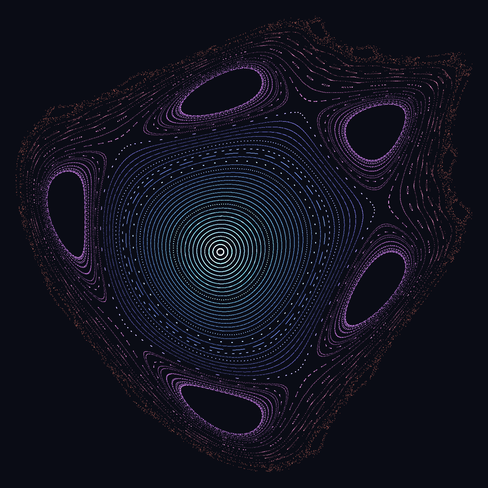

# KAM tori on `lapack_rs`

> Can inner product, matrix multiplication, diagonalization and Gram–Schmidt
> model KAM tori? Mostly **no** — the phenomenon is nonlinear, symplectic and
> arithmetic, and those four operations are the *linear* analysis layer. But add
> one nonlinear area-preserving map and the exact-real carrier, and this repo
> can both **detect** KAM tori and show them exactly where floating point lies.



*Poincaré phase portrait of the Hénon map at rotation number ρ ≈ 0.21. The cyan
core is a nest of surviving KAM tori; the five violet loops are the 1/5 resonant
island chain; the orange haze is the chaotic layer along the broken separatrix.
Computed and rasterised entirely in Rust — no plotting library, no Fortran.*

**Play with it live:** the interactive explorer (rotation-number dial + resonance
presets) is published as an Artifact — turn the dial and watch tori shatter into
islands and chaos.

## What KAM actually needs — and what it doesn't

A KAM torus is an invariant torus of an integrable Hamiltonian that *survives* a
small nonlinear perturbation, provided its frequency vector ω is Diophantine
(|⟨ω, k⟩| ≥ γ/|k|^τ) and a twist condition holds. The surviving tori form a
Cantor set of positive measure; the resonant gaps break into islands and chaos.

For the canonical 2-D test-bed, the machinery collapses:

| Question | What it reduces to | In this repo |
|---|---|---|
| Frequencies / resonance ⟨ω, k⟩ | an **inner product** | `dot` — exact over `CReal` |
| Area preservation | **det of a 2×2** = 1 | `kam::det2` |
| Elliptic vs hyperbolic | **trace of a 2×2** | `kam::residue`, R = (2 − tr)/4 |
| Torus vs chaos | largest **Lyapunov exponent** | `kam::lyapunov_renorm` (via `nrm2`) |

Everything is the **trace of a 2×2**. No non-symmetric eigensolver is needed
(that only returns in ≥ 3 degrees of freedom); `jacobi_eigen` is symmetric-only
and never appears; Gram–Schmidt is needed only for the *full* Lyapunov spectrum
in higher dimensions. The one `lapack_rs` routine on the critical path is `nrm2`.

## The map, and why this one

The canonical standard map `p′ = p + K·sin θ` needs `sin`, which is in neither
carrier and would be a truncated series — re-introducing approximation exactly
where the exact carrier exists to remove it. So we use **Hénon's 1969
area-preserving quadratic twist map**, which needs only `+ − ×`:

```text
v  = y − x²
x′ = c·x − s·v
y′ = s·x + c·v        with c² + s² = 1
```

Written in the `Scalar` trait, it runs `::<f64>` and `::<CReal>` from one body —
the same "one algorithm, two carriers" discipline as the rest of the repo.

With the **Pythagorean rotation** `(c, s) = (3/5, 4/5)` the coefficients are
rational, so the orbit of a rational seed is a sequence of *exact rationals* over
`CReal`. Two hand-checkable anchors fall out:

- **Area preservation is exact.** det J = c² + s² = 1 for every x. Over `CReal`
  it is 1 *bit-for-bit*; in `f64` the cancellation in the 2csx terms drifts by
  ~10⁻⁷ at large x (and erratically — exact at some magnitudes, wrong at others).
- **The two fixed points carry rational residues.** The origin (elliptic) has
  R = +1/5; the point (1, 1/2) (hyperbolic) has R = −1/5. Over `CReal` these are
  *exactly* ±1/5, not floating-point near-misses.

## Modules

- **`src/comonad.rs`** — the `Stream` comonad: `extract` (counit), `duplicate`
  (comultiplication), `extend` (run a co-Kleisli arrow at every position), and
  `iterate` (the cofree orbit). "Iterate the map" *is* unfolding the step rule
  into this comonad; "measure it along the orbit" *is* `extend`.
- **`src/kam.rs`** — the Hénon map, its Jacobian, the trace/residue classifiers,
  and the tangent flow for the Lyapunov exponent — all generic over `Scalar`.

## Running it

```bash
cargo test --test kam                      # 9 exact anchors (det = 1, R = ±1/5, comonad laws)
cargo run --example kam_demo               # the f64-vs-CReal story in one screen
cargo run --release --example phase_portrait > points.js   # orbit data for the web plate
cargo run --release --example render_png   # writes phase_portrait.ppm → docs/phase_portrait.png
```

## Honest caveats

1. **Exact quadratic iteration is doubly-exponential.** `x²` doubles the rational
   height each step, so exact orbits over `CReal` are feasible only for ~15 steps
   (the agreement test uses 12). For deep orbits use the `irram::run` driver,
   which fixes a target precision instead of growing a DAG.
2. **The map is unbounded.** Seeds outside the stability island escape to ∞ —
   that is *not* chaos, and the demo labels it honestly (an escaping orbit has a
   NaN Lyapunov exponent, not a positive one).
3. **The portrait is f64.** The structure is the point there; the *exact* side —
   det = 1 and R = ±1/5 over `CReal` — is specific to the rational setting
   c = 3/5 and lives in the tests and `kam_demo`, not the picture.

## The point

Detecting and locating KAM tori is within reach of a nonlinear iterator plus
`nrm2` — the heavy linear algebra stays in the drawer. And where it counts
(symplecticity, the residue classifier) the exact `CReal` carrier makes the
answer *exact*, not approximately-signed — which is the whole reason this repo
reimplements LAPACK in Rust rather than shipping the f2c'd Fortran.
